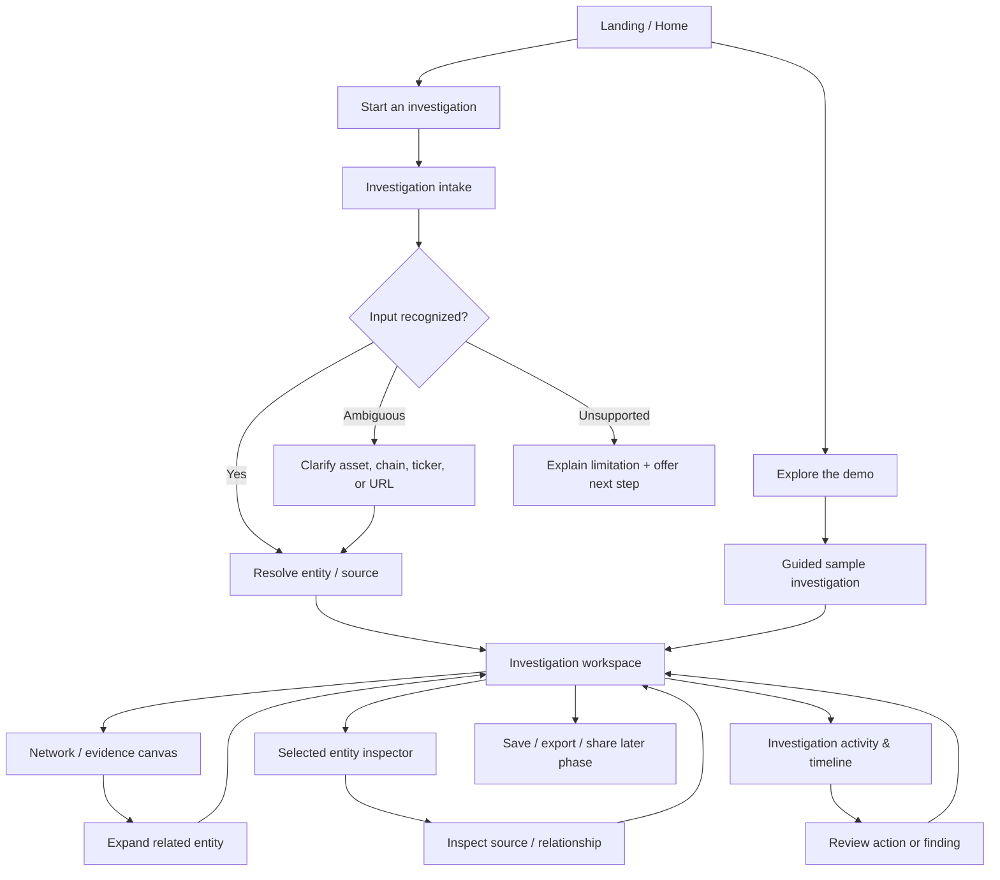
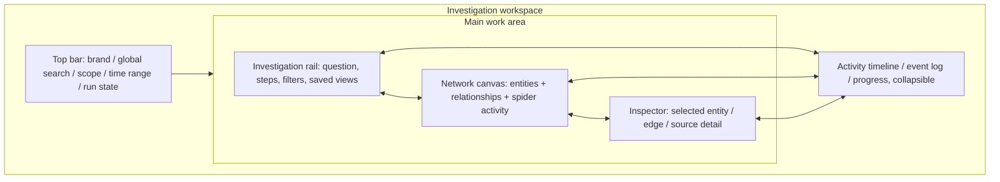
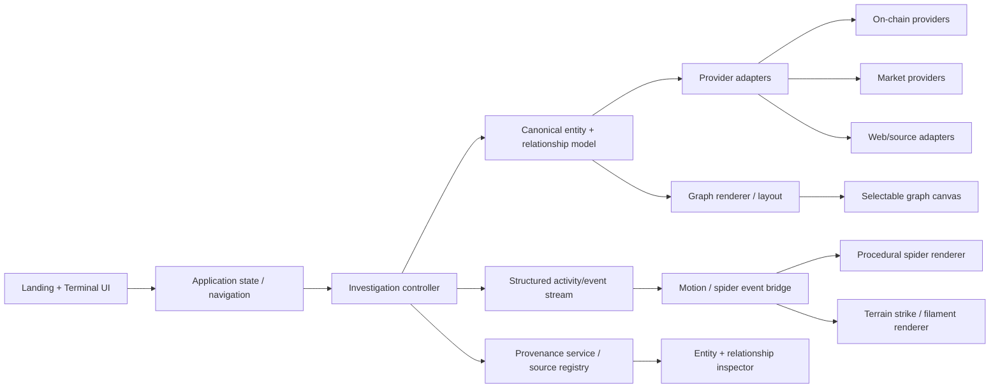

# OpiumCrawl — Master Product, Design & Architecture Brief

**Status:** Proposed source of truth for design and architecture planning  
**Phase:** Design/specification before major implementation  
**Product name:** OpiumCrawl (exact spelling; do not rename)  
**Audience:** Product owner, design/engineering agents, future contributors

> This is the baseline brief to refine after inspecting the current repository. It distinguishes confirmed project context from design proposals. Any mismatch with the existing code must be documented, not silently guessed away.

---

## 0. How to use this document

This brief governs product intent and design direction. It does **not** authorize a blind rewrite. Before implementation, Claude Code must inspect the repository and reconcile this proposal with the running application, current source, existing assets, and handoff notes.

When a decision changes, update the appropriate document and `DECISIONS.md`. Do not let the code, prompts, and product brief drift apart.

### Document hierarchy to establish in the repository

1. `CLAUDE.md` — mandatory operating rules for all coding-agent sessions.
2. `docs/product/PRODUCT_BRIEF.md` — purpose, users, scope, product principles, non-goals.
3. `docs/design/DESIGN_SYSTEM.md` — visual tokens, typography, components, visual hierarchy.
4. `docs/product/EXPERIENCE_MAP.md` — sitemap, key journeys, page/state transitions.
5. `docs/product/TERMINAL_SPEC.md` — detailed investigation workspace and interaction behavior.
6. `docs/design/MOTION_SYSTEM.md` — animation, spider behavior, environment response, accessibility/performance.
7. `docs/architecture/TECHNICAL_ARCHITECTURE.md` — components, boundaries, events, proposed architecture.
8. `docs/architecture/DATA_MODEL_AND_PROVENANCE.md` — entity types, relations, data quality, provenance and demo/live states.
9. `docs/roadmap/IMPLEMENTATION_ROADMAP.md` — staged build plan and acceptance gates.
10. `docs/research/REFERENCE_LIBRARY.md` — external references, what we learn from them, what not to copy.
11. `docs/DECISIONS.md` — dated decisions and alternatives considered.

The repository may already have docs that serve these purposes. Inspect and reuse them where sensible instead of duplicating material.

---

## 1. Product in one sentence

**OpiumCrawl is an interactive intelligence and investigation workspace that helps people follow relationships between financial assets, wallets, transactions, and information found across the web. A procedural spider gives the system a visible presence and helps make the act of investigation understandable.**

This sentence is a strategic proposal, not a claim that every data provider or agent capability is already implemented.

### Product promise

**Follow the signal. See what connects. Understand why.**

The product should turn an initial lead—such as a token, wallet, ticker, transaction, address, or URL—into an explainable investigation. The interface should make the evidence and the path of inquiry visible, not merely return a generic AI answer.

### Product is not

- Just a landing page with a cool spider.
- A decorative sci-fi dashboard with made-up numbers.
- A terminal that looks technical but has no useful workflow.
- An autonomous agent whose actions cannot be inspected or interrupted.
- A graph that implies relationships without showing why they exist.
- A trading terminal promising execution unless that is deliberately scoped and implemented later.

### Primary design hypothesis

The spider is not the entire product. It is the **embodiment of attention and exploration**. The investigation workspace is the product. Visual effects should make real or explicitly demo interactions easier to understand.

---

## 2. Users and core jobs

### Primary user: curious investigator / crypto-native researcher

They start with a lead, need to inspect connected entities, and want to know what is relevant without manually opening a dozen tools.

**Jobs to be done**
- Search a public address, token, transaction hash, ticker, asset, entity, or URL.
- Understand holdings, activity, counterparties, ownership-like relationships where supported, and transaction paths.
- Move from one entity to connected entities without losing the investigation's context.
- See the source, timestamp, chain/market, and strength of each claim.
- Save a useful investigation and return to it.

### Secondary user: market / on-chain analyst

They compare multiple leads, inspect time windows, track a thesis, and need an auditable history of what the investigation concluded and why.

### Secondary user: agent-assisted browser researcher

They want an agent to navigate sources and interfaces. They need a clear view of what the agent is doing, what it observed, what remains uncertain, and where user approval is needed.

### Design principle

**The agent may accelerate the investigation, but the user must remain oriented and in control.** Never hide uncertainty, source gaps, failed actions, or demo data behind a confident-looking animation.

---

## 3. Scope boundaries

Because existing integrations and code must be audited before scope can be finalized, classify each capability as `implemented`, `partially implemented`, `planned`, or `demo-only` after repository inspection.

### Intended product domains

- **On-chain entities:** wallets/addresses, tokens, transactions, contracts, protocols, counterparties, and supported cross-chain relationships.
- **Market entities:** listed equities, crypto assets, tokenized assets, market events, prices, and time-series metrics where a real data source exists.
- **Web intelligence:** URLs, public pages, documents, source claims, and evidence extracted by an agent or added by a user.
- **Investigations:** saved starting points, graph snapshots, notes, questions, findings, sources, and event history.

These domains should not be represented as fully integrated until source support is implemented and tested.

### MVP target

Build one high-quality, working end-to-end investigation journey on clearly labeled sample data, with an architecture that can later connect real providers. The MVP must prove that the UI model is coherent before adding many data sources.

**MVP should include:**
1. Landing page with a clear product explanation and interactive spider.
2. Start investigation from a search/query.
3. A working investigation workspace.
4. One cohesive demo dataset with entity and relationship detail.
5. Search/select/expand/filter/focus graph interactions.
6. Inspect a selected entity and inspect a relationship/edge.
7. Visible source/provenance and a timeline or ordered event log.
8. Save/restore only if the current stack can support a simple reliable implementation; otherwise clearly defer it.
9. Distinguish demo data from live/verified data.

**Defer unless already implemented and reliable:**
- Trading/execution, wallet signing, custody, financial recommendations, user accounts/billing, arbitrary multi-chain breadth, complex collaborative cases, custom query language, and production agent autonomy.

---

## 4. Product principles

1. **Signal over spectacle.** The animation must clarify attention, relationships, or state.
2. **Every claim has a source.** Show source, timestamp, and relevant context where possible.
3. **Every relationship has a meaning.** Edge direction, type, value, time, and source should be available.
4. **Progressive disclosure.** Show the minimum useful structure first; reveal detail on selection or request.
5. **The user stays oriented.** Maintain visible current subject, scope, filters, time range, and investigation history.
6. **Agent activity is observable.** Communicate observing, searching, reasoning, verifying, complete, blocked, and error states without exposing private chain-of-thought.
7. **Demo is never disguised as live.** Use consistent badges/labels and deterministic seeded data.
8. **Keyboard and pointer both work.** Core workflows must not depend only on hover.
9. **Motion has a reason.** Establish cause and effect, and include reduced-motion behavior.
10. **A beautiful failure is still a failure.** Loading, no-results, permission, provider failure, empty, stale, and disconnected states deserve design.

---

## 5. Brand and art direction

### Creative thesis

A **living digital terrain** where the spider is a visible investigator and the landscape reveals a hidden network only when there is a reason to reveal it.

This combines three layers:

- **World:** the original grainy dune environment, dark foreground, lavender / pink / burnt-orange horizon.
- **Creature:** the procedural spider, rendered independently with real movement and clear intentional behavior.
- **Intelligence layer:** thin fibrous connections, contact strikes, scan cues, graph links, and investigation annotations that respond to real UI/agent events.

### Palette direction

Keep the original image as the preferred baseline unless an in-browser side-by-side comparison proves the Firefly video provides a better composition.

Proposed tokens (final values must be sampled from approved assets and tuned in browser):
- `background-0`: near-black violet.
- `background-1`: deep indigo / plum.
- `surface-1`: dark violet-gray, used for quiet panels.
- `text-primary`: soft near-white.
- `text-secondary`: muted lavender-gray.
- `accent-violet`: restrained lavender.
- `accent-magenta`: rose / electric magenta for active traces.
- `accent-warm`: muted peach / burnt orange for rare horizon highlights.
- `signal-hot`: pink-white, reserved for contact flashes or critical focus.
- `success`, `warning`, `danger`: accessible functional colors, not just decorative variants.

Do not use bright magenta on every surface. Most pixels should remain dark. Accent color should tell the user what is active, selected, newly discovered, or important.

### Texture and depth

- Preserve fine grain and layered depth in the background.
- Avoid stacking video, heavy grain overlay, particle systems, scanlines, glow, and animated filaments all at once.
- The environment should be slow or nearly still while the headline or terminal task is active.
- Keep important foreground information on calm/dark areas or apply a carefully tested local scrim.
- Do not force the landscape into every terminal screen. The investigation workbench may use a much quieter, flatter near-black surface for precision work, with the terrain used selectively as a transition or subtle edge texture.

### Typography

- Use the existing pixel-inspired display face as a brand accent only if readable at real responsive sizes.
- Pair with a clean, highly legible interface sans or mono face for product text, table values, addresses, hashes, timestamps, and metadata.
- Display type should be editorial and memorable; data type must be dense but clear.
- Define explicit text styles for display, page title, section title, body, compact metadata, code/address, numerical values, and status.
- No important text should rely on letter-by-letter effects to be understandable.

### Surfaces and components

- Prefer thin borders, precise rules, open layouts, and purposeful panel contrast.
- Use glass sparingly. Avoid turning every component into a translucent card.
- Keep node/edge colors semantically consistent.
- Make active selection legible through a combination of glow, outline, label, and panel selection—not color alone.
- Avoid arbitrary decorative metrics, fake uptime claims, fake inference speed, and unsupported social proof.

---

## 6. Experience map — product-level page map



### Primary happy path

1. User lands on the page and understands what OpiumCrawl does within seconds.
2. The user sees the spider in a recognizable but non-obstructive idle state.
3. User starts an investigation or opens the guided sample.
4. Intake resolves the input into an entity, URL, or explicit ambiguity state.
5. Workspace opens with the root subject in focus and a small set of supported relationships.
6. User selects a node or edge; inspector updates without losing canvas context.
7. User expands one relationship; the graph adds nearby nodes and records the action in the activity timeline.
8. User inspects the source and can distinguish facts, derived values, hypotheses, and unavailable information.
9. User can return to root, reset filters, or start a new investigation.

### Global navigation proposal

Keep the top-level navigation small until usage validates a larger information architecture:
- **Investigate** — primary workspace.
- **Recent** — history, if implemented.
- **Watchlists** — defer or demo only until subscriptions/refresh logic exist.
- **About / Method** — how sources, demo data, and the agent work.

Do not create a large nav full of empty pages. Navigation should follow working product capabilities.

---

## 7. Terminal / investigation workspace — recommended layout

“Terminal” here means the user's investigation workbench, not a fake command-line prompt. A command/search bar can exist, but the main interface should be a visual, inspectable workspace.

### Layout map



### Recommended desktop composition

- **Top bar:** stable and compact. Product identity, universal search / command input, current investigation title, data/demo status, time range or scope, and run/pause control if an agent is genuinely running.
- **Left rail/panel:** investigation question and ordered activity. Collapsible so the graph can take more space. Keep parameters and filters close to the question they affect.
- **Center canvas:** primary visual focus. Nodes, directed/typed edges, selection, zoom/pan, fit-to-view, root-focus, minimap only if it earns its space, and graph empty/loading states. The spider may visually travel through this canvas, but graph nodes/edges remain accessible independently.
- **Right inspector:** contextual panel that changes based on selected entity/edge. It has a predictable structure; don't open a new modal for every selection.
- **Bottom activity/timeline:** collapsible history of agent actions, expanded nodes, source checks, observations, and time-ordered events. Avoid making a verbose raw log the default.

A useful starting layout is a narrow global icon rail, left contextual panel around 250–300 px, flexible center canvas, right inspector around 300–360 px, and a collapsible bottom timeline. Treat these as responsive starting ranges, not fixed requirements. Validate against the actual viewport and graph library.

### Initial canvas rules

- Start with a coherent small graph, not dozens of random nodes.
- Keep the root entity clear and visually anchored.
- Use consistent encoding for entity type and relation type.
- Edge direction must be obvious where direction matters.
- Selecting an edge reveals relation details, source, timestamp, and value if available.
- Hover may preview, but click/tap and keyboard must also work.
- Add/remove/focus/expand actions need undo or a clear way back when meaningful.
- Provide fit-to-view, zoom, pan, focus-root, and clear-selection controls.
- Filters should say what they filter and show when active.
- Prevent graph labels from colliding unnecessarily; allow labels to appear progressively by zoom level if needed.
- Large graphs must have a strategy for clustering or expansion limits; do not render everything at once.

### Entity inspector template

1. Entity type + canonical display name.
2. Key identifier (address, contract, ticker, transaction hash, URL) with copy action.
3. Chain / market / source and last-updated timestamp, when applicable.
4. Relevant overview metrics only when backed by data.
5. Connected entities / counterparties.
6. Recent activity / event history.
7. Provenance/source list.
8. Actions: focus in graph, expand connections, add note, bookmark/save if supported.

### Edge / relationship inspector template

- Relationship label (transfer, swap, ownership association, same-source mention, temporal correlation, etc.).
- Source and direct evidence.
- Direction and endpoints.
- Amount/unit/time if available.
- Direct vs inferred relationship status.
- Confidence only if the methodology for confidence exists and is documented.
- Explicit unknown/unavailable state where data is missing.

### Agent / crawler status model

Use visible, controlled statuses such as:
- `Idle` — ready for input.
- `Resolving` — identifying the initial entity or source.
- `Observing` — reading page/interface or collecting available data.
- `Tracing` — following a known relationship.
- `Checking` — validating a source or resolving conflicting information.
- `Finding` — preparing a concise observation with linked provenance.
- `Completed` — actions finished; clearly separate completion from correctness.
- `Needs input` — asks the user to resolve ambiguity.
- `Blocked` — permissions, unsupported provider, rate limit, or missing data.
- `Error` — concise explanation and retry/recovery action.

Only show statuses that correspond to actual implementation events. A simulated demo may animate them, but must carry a demo label.

---

## 8. Visual system and motion grammar

### Core concept: a living terrain of inquiry

The site follows a visual sequence: the user notices a lead; the spider approaches; contact reveals a local trace; the trace resolves into a relationship; the terminal exposes the supporting information.

**Do not make every element move at once.** Motion is staged and selective.

### Motion priority hierarchy

1. **Critical content:** headline, selected entity, active question, important result. Always readable; brief entrance only.
2. **Spider:** main interactive character; clear posture/intent and controlled locomotion.
3. **Meaningful graph motion:** node focus, path propagation, camera/focus change, expansion.
4. **Atmospheric movement:** very slow background drift or video movement; barely noticed.
5. **Decorative details:** rare particles or texture; no continuous particle storm.

### Proposed motion sequence for first load

1. Background is already visible or fades in subtly—no prolonged loading theatre.
2. Eyebrow reveals.
3. Headline reveals by line with a clipped vertical lift.
4. Supporting copy appears.
5. CTA arrives last.
6. Spider begins/continues a restrained idle gait after content is readable.

Keep the entire hero entrance brief; never block the primary action behind an extended animation.

### Terrain strikes: meaning, not decoration

- Idle landscape: nearly still, very faint strands only.
- Foot plant: small bright contact pulse and a short filament, sourced from a real or explicitly simulated foot-contact event.
- Ordinary crawling: only occasional short trails; no persistent web growing without limit.
- Investigation target: a stronger, local scan pulse reveals nearby paths.
- Verified or demo relationship selected: illuminate the particular relationship path; label its basis.
- Finished state: effects quiet down; leave only the useful selected path visible.

For a static/video backdrop, do not pretend to reconstruct real 3D geometry. The overlay may use a subtle 2.5D projection, screen-space curves, and local masks. Clearly separate decorative terrain threads from actual graph relationships.

### Landing page sections

1. **Hero:** brand, clear headline, short explanation, primary CTA, secondary “watch the investigation”/demo action, spider in view.
2. **How it works:** three steps—Start with a lead → Follow connections → Inspect the evidence.
3. **Interactive miniature investigation:** a small deterministic demo that explains the spider/canvas relationship; never a fake live scan.
4. **What can be investigated:** only domains the planned data model can support; mark planned integrations honestly.
5. **Trust/provenance:** explain how sources, timestamps, direct vs inferred relationships, and demo/live status are handled.
6. **Final CTA:** start the real/demonstration investigation.

Don't turn the landing page into a long motion-design reel. The actual investigation workspace must be reachable early.

### Accessibility and performance requirements

- Respect `prefers-reduced-motion`; replace nonessential movement with a still state or short opacity transition.
- Avoid flashing and high-frequency pulsing. No effect should depend solely on color.
- Do not run the heaviest animation loop when its canvas is offscreen or the tab is hidden.
- Keep the video muted, `playsinline`, and optional; provide a static fallback.
- Measure real frame rate, CPU, memory, video weight, and loading rather than assuming the effect is free.
- For Canvas: manage device pixel ratio and resize, batch drawing, avoid costly per-frame work and excessive blur/shadow, and clean up listeners/animation frames.
- Offer an intentional low-motion/low-power mode if profiling shows it is needed.

---

## 9. Information architecture and behavior map

### Search / intake behavior

Input examples: address, transaction hash, token name/ticker/contract, stock ticker, URL, or natural-language question if that is actually supported.

Resolve in this order:
1. Normalize input without destroying the raw input.
2. Identify plausible input type and relevant chain/market/context.
3. If ambiguous, ask a useful clarification instead of choosing silently.
4. Query configured providers/adapters only.
5. Show provider/source availability and loading/error states.
6. Create or open a workspace with a root subject, scope, and provenance.

If no provider is connected, show the demo path or state clearly that live lookup is unavailable. Never present seeded demo graph data as real observations.

### Core terminal actions

- Search/open a subject.
- Select entity or relationship.
- Expand one relationship layer.
- Focus the canvas on a node.
- Inspect source/provenance.
- Set or clear a filter/time window.
- View activity/timeline.
- Reset to root / fit graph.
- Start over.

### Empty/error/recovery map

- Empty workspace: explain what input works and offer an example.
- Ambiguous input: show detected possibilities.
- No connections: show whether none were found, the provider returned none, or the source is unsupported.
- Provider unavailable: preserve user context; allow retry or demo mode.
- Partial results: mark the graph as partial and identify missing providers.
- Conflicting sources: show the conflict with timestamps, don't silently choose.
- Agent blocked: show cause, action already completed, and the next safe action.
- Browser/device limitation: degrade gracefully and preserve core navigation.

---

## 10. Data model and provenance principles

Use a provider-neutral canonical model so integrations can be added without rebuilding the UI around one API. Final schema must follow actual provider capability and repository design.

### Candidate entities

`Wallet`, `Token`, `Transaction`, `Contract`, `Protocol`, `Equity`, `MarketEvent`, `WebPage`, `OrganizationOrService`, `Investigation`, `Source`, `Observation`, `Note`.

Not every entity type belongs in MVP. Pick one vertical slice based on existing functionality and available data.

### Candidate relationship shape

`Relationship { id, sourceEntityId, targetEntityId, type, direction, observedAt, validFrom?, validTo?, amount?, unit?, chainOrMarket?, provenanceIds[], status, confidence? }`

Fields only appear when supported. `confidence` must not be invented as a decorative score. Status should distinguish direct observation, provider-labeled association, derived relation, hypothesis, and demo relation.

### Provenance

Every material observation should preserve:
- source/provider identifier;
- original source URL or transaction/block reference where available;
- retrieval/observed time;
- relevant chain/market/network;
- whether the value is raw, normalized, derived, or inferred;
- limitations and missing context;
- data freshness/availability status.

The UI should let a user move from a node or connection back to the information that supports it.

### Agent event stream

Use a structured event contract rather than tightly coupling UI elements to a specific agent harness. Candidate event types:
- `investigation.started`
- `input.resolved`
- `source.requested`
- `source.observed`
- `entity.discovered`
- `relationship.discovered`
- `relationship.verified`
- `relationship.disputed`
- `graph.node.selected`
- `graph.neighborhood.expanded`
- `agent.needs_input`
- `agent.blocked`
- `investigation.completed`
- `investigation.failed`

Events should carry IDs, timestamps, correlation/investigation ID, and a safe UI payload. Do not expose private internal reasoning as public event text; use concise action summaries and evidence references.

---

## 11. Technical architecture direction (not a mandate to rewrite)

First inspect the real stack. Current visible project context has included `index.html`, `main.js`, `styles.css`, `public/`, and `assets/reference/`, but repository reality must be verified before architecture is finalized. Do not assume React, Next.js, Canvas, or a graph framework is already installed.

### Recommended separation of concerns



### Key boundaries

- **UI/application state:** selected entity, open panels, search state, filters, active investigation.
- **Investigation controller:** orchestrates actions and turns provider responses into canonical observations/events.
- **Provider adapters:** keep provider-specific fields and failure modes out of the UI; no live provider secrets in browser code.
- **Canonical graph:** stable IDs, entity types, relationship semantics, source references.
- **Graph presentation:** layout and interactions only; does not invent data meaning.
- **Spider renderer:** body/leg animation and targets, not data fetching or product decisions.
- **Terrain effects renderer:** consumes normalized visual events; does not infer financial facts.
- **Motion bridge:** maps product events to restrained motion cues.
- **Provenance layer:** source references and timestamps accessible to both graph and inspector.

### Architecture choices must be evidence-based

Before choosing or adding a library, inspect the current stack, graph size target, animation requirements, license, bundle cost, touch support, accessibility, export options, and active maintenance. Prefer a small working implementation over an ambitious new graphics stack unless real constraints justify it.

### Performance guidance

- Use CSS transforms/opacity for straightforward UI transitions where practical.
- Use an animation library already present before adding another.
- Use `requestAnimationFrame` for canvas loops; stop when not visible/needed.
- Layer static and frequently-changing graphics where appropriate.
- Keep graph rendering independent from spider/terrain animation.
- Avoid full React/component rerenders on every animation frame.
- Profile; do not promise specific FPS until measured.

---

## 12. Research and reference map

These links are research inputs, not designs to copy. Claude must read the pages directly when possible, capture visual/interaction takeaways, note dates, and compare against the current product rather than merely repeat this list.

### A. Motion intelligence and visual storytelling

1. **GMUNK — TRON: Ares, Computer Vision**  
   https://gmunk.com/TRON-Ares-Computer-Vision  
   Study: scene-first analysis; find points of interest; connect tracking, analysis, and data through fibrous linework; make graphics communicate perception and cause-and-effect. Important nuance: detail is useful only when hierarchy preserves readability.

2. **GMUNK — TRON: Legacy**  
   https://gmunk.com/TRON-Legacy  
   Study: animated line systems, data organization, generative effects, and the trade-off between spectacle and quick readability. Their write-up explicitly notes that a dense globe sequence was simplified because too much detail confused the read.

3. **Motion for React — scroll animations**  
   https://motion.dev/docs/react-scroll-animations  
   Study: difference between scroll-triggered and scroll-linked effects; reserve each for situations where it adds meaning.

4. **Motion `useScroll`**  
   https://motion.dev/docs/react-use-scroll  
   Study: progress-linked parallax and transformation if the repository uses React/Motion or an equivalent is appropriate.

5. **GSAP ScrollTrigger**  
   https://gsap.com/docs/v3/Plugins/ScrollTrigger/  
   Study only if the project already uses GSAP or there is a clear need. Do not add overlapping animation systems without justification.

### B. Investigation and graph UX

6. **Chainalysis Reactor**  
   https://www.chainalysis.com/product/reactor/  
   Study: tracing paths, readable transaction interpretation, annotation, case/story presentation, and source clarity.

7. **Arkham Visualizer**  
   https://codex.arkm.com/the-intelligence-platform/visualizer  
   Study: search-to-graph workflow, node movement/expansion, edge hover details, direction semantics, filters, and time/amount controls.

8. **Nansen Profiler guide**  
   https://academy.nansen.ai/en/help/articles/0002013-nansen-profiler-101  
   Study: selected-wallet context, holdings, counterparties, activity and pairwise relationship investigation.

9. **WebCrawlerMY procedural crawler**  
   https://github.com/felixyu9722/WebCrawlerMY  
   Study: procedural IK gait, canvas spider, scanning, and interaction mechanics as a technical reference—not as an identity to clone.

### C. Technical guardrails

10. **MDN — Optimizing canvas**  
    https://developer.mozilla.org/en-US/docs/Web/API/Canvas_API/Tutorial/Optimizing_canvas  
    Study: device-pixel scaling, caching, layered canvases, minimizing repeated draw work, and avoiding expensive effects.

11. **MDN — `prefers-reduced-motion`**  
    https://developer.mozilla.org/en-US/docs/Web/CSS/Reference/At-rules/%40media/prefers-reduced-motion  
    Study: provide a deliberate reduced-motion presentation, not just a perfunctory media query.

12. **MDN — animation performance and frame rate**  
    https://developer.mozilla.org/en-US/docs/Web/Performance/Guides/Animation_performance_and_frame_rate  
    Study: avoid janky animation and measure the actual cost of video and scripted graphics.

### Research rules

- Visit the original source; do not rely only on search snippets.
- Record the exact takeaway and the corresponding OpiumCrawl decision.
- Distinguish observed feature from interpretation/opinion.
- Do not copy protected visuals, layout, words, brand marks, or exact animation sequences.
- Prefer fewer, deeper references over a long decorative moodboard.

---

## 13. Prioritized implementation roadmap

### Phase 0 — Discovery and design lock (current phase; no product implementation)

Deliver:
- Repository and asset inventory.
- Confirmed stack, entry points, routes/pages, existing spider/background behavior.
- Reference library with notes.
- Product brief, experience map, terminal spec, design system, motion spec, data/provenance model, architecture map, roadmap, decision log.
- Explicit list of unknowns and decisions requiring owner approval.

Exit gate: no major conflicts across documents; one coherent MVP slice and terminal layout agreed. Do not start terminal implementation during this phase.

### Phase 1 — Core shell and static composition

Deliver:
- Responsive landing and terminal shell.
- Typography/colors/tokens/components.
- Search/intake and workspace states using deterministic demo data.
- Graph/inspector/activity layout with empty/loading/error states.

Exit gate: the user can understand and navigate the product without depending on animation.

### Phase 2 — One complete investigation workflow

Deliver:
- Start with a known sample entity.
- Expand/select graph relationships.
- Inspect relation and provenance.
- Activity log reflects actual demo actions.
- Clear route back to root and reset.

Exit gate: a user can complete the whole demo journey without dead ends or misleading states.

### Phase 3 — Motion integration

Deliver:
- Hero text choreography.
- Procedural spider behavior integrated with targets and states.
- Contact strike/filament effects triggered by meaningful events.
- Scroll storytelling only where it improves comprehension.

Exit gate: motion communicates state and does not reduce legibility, performance, or control.

### Phase 4 — Real data integration

Choose one vertical slice based on available credentials, APIs, rate limits, licensing, and reliability. Do not build multiple providers simultaneously without a clear need.

Deliver provider adapter(s), normalization, provenance, failure modes, freshness indicators, tests, and visibly distinct demo/live modes.

Exit gate: every displayed live claim can be traced to a source and relevant time.

### Phase 5 — Hardening and release

- Responsive behavior and input modes.
- Accessibility and reduced-motion audits.
- Performance measurements and budgets.
- Security/privacy review for external pages and user-provided URLs.
- Tests for key states and failure/recovery flows.
- Product analytics only if defined and privacy-respecting.
- Documentation updated to reflect real implementation.

---

## 14. Acceptance criteria — definition of done

A feature is not done because it looks right in one screenshot. A feature is done when:

- The UI state maps to real application state or an explicitly labeled demo.
- Main interaction works with mouse, keyboard, and touch where relevant.
- Loading, empty, error, blocked, and success states exist.
- Related provenance/source detail is inspectable where a claim or relationship appears.
- Layout works at practical desktop and mobile widths.
- Reduced-motion preference is respected.
- Animation doesn't break text readability, hit targets, or page navigation.
- No unnecessary continuous loops or unbounded visual trails.
- Relevant test/build checks pass, or failures are documented.
- The responsible docs are updated.

---

## 15. Open decisions for the design-lock review

Claude must not silently decide these where repo inspection cannot resolve them. It should recommend one option and explain trade-offs.

1. Is the core product positioned first as **on-chain investigation**, **cross-domain financial intelligence**, or **web-intelligence agent for markets**? Proposal: broad cross-domain vision, one narrow on-chain-first or demo-first MVP.
2. What one dataset can reliably support the first real-data workflow?
3. Does the spider operate across the landing page only, or also inside the investigation canvas? Proposal: idle/intro on landing; meaningful investigation cues in the terminal, with different behavior contracts.
4. Is the terminal graph a true data graph with spatial layout, or should it present a guided flow for the first MVP? Proposal: a small graph with a guided activity stream.
5. Which existing background asset is best after side-by-side in-browser testing? Proposal: preserve the original unless the Firefly motion clearly improves hierarchy.
6. Is “Start investigation” the primary CTA or should users first explore a guided demo? Proposal: primary action starts a demo-capable investigation immediately; secondary CTA previews the spider.
7. Are save/history features within the first slice? Proposal: recent session state only until persistence requirements are known.

---

## 16. Decision log template

Append each substantive decision to `docs/DECISIONS.md`:

```md
## DEC-XXX — Short decision title
- Date:
- Status: proposed | accepted | superseded
- Context:
- Decision:
- Alternatives:
- Evidence/references:
- Consequences:
- Documents/code affected:
```

---

## 17. Source notes

This brief combines project context discussed with the user, design proposals, and publicly documented external references. Product capability, stack, and asset behavior must be verified against the actual repository. Reference sites demonstrate patterns; they do not establish requirements for OpiumCrawl.
