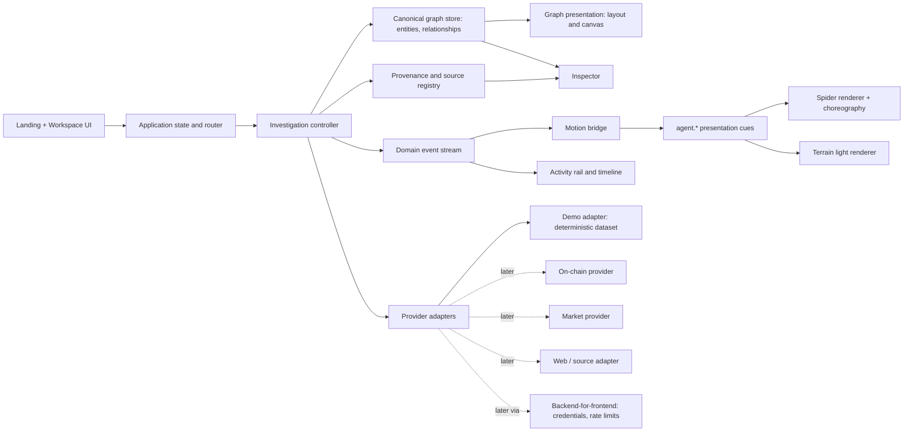

# Technical Architecture

Status: Section 1 (current) is **confirmed by repository**. Sections 2 onward are **proposed**; nothing proposed is built. Stack decision: DEC-003.

## 1. Current system (confirmed, 2026-10-11)

**Stack:** static `index.html` + `styles.css` + native ES modules. No `package.json`, bundler, framework, tests, or lint. External requests: Google Fonts (Inter), `db.onlinewebfonts.com` (pixel display face), and, only when the user pastes a Bitcoin address, `blockstream.info/api` (DEC-027). Dev server: `python3 serve.py` (no-cache static server on 127.0.0.1:3003, DEC-024). Plain `http.server` lets browsers cache edited ES modules.

**Tree** (project root is `/Users/mac/Desktop/coding/oss/dejavu`):

```
index.html            landing and terminal markup; both views in one document
main.js               composition root: wires modules, menu, tour, transition, terminal
styles.css            all styling (1221 lines), tokens in :root
js/
  background.js       BACKGROUND config (enabled, terrain, video, poster) + mounting
  router.js           hash router: landing and terminal views
  motion.js           scroll reveals, scroll dim, story graph steps
  preferences.js      per-viewer Calm preference (localStorage, safe fallback)
  investigation.js    store reducing agent.* cues (used by the landing tour status)
  simulation.js       demo-only landing tour (runLandingTour)
  model/              model.js (ids, labels), demo-dataset.js (demo-v1), queries.js (graph queries, Verified rule)
  investigation/      reducer.js (domain events to state), controller.js (open, expand, select, live and demo flows), demo-adapter.js (input detection and routing), bitcoin-adapter.js (Blockstream), recents.js, motion-bridge.js
  workspace/          workspace.js (UI wiring), graph-view.js (SVG), inspector.js, demo-layout.js
  spider/
    events.js         EVENT_TYPES, createEvent, createEventBus
    spider.js         Canvas 2D spider: gait, FABRIK, silk, hooks (onFootPlant, onTouch, onLink)
    ik.js             FABRIK solver
    choreography.js   behavior state machine: intro, ambient, curious, startled, visiting, agent, transition
    targets.js        DOM target discovery, anchors, ensureVisible
    geometry.js       rectOf (text extent for masked lines)
  terrain/
    contours.js       ridge curves in video space (original background only)
    graph.js          network build, layout, nearest node, shortest path
    terrain.js        Canvas 2D light layer: strikes, scans, connection paths
assets/               logo.svg, background-poster.jpg (Firefly), reference/ (original video, frames, a screen recording)
public/               Firefly exports and the seamless-loop re-encode
fonts/                GeistPixel-Circle.woff2
docs/                 this documentation set
```

Stray files at the root (not used by the page): `KAW8qq-EfhNOR8AM.mp4` (a 1440x1440, 60 fps, 16.7 s clip with audio showing a cyan-line spider crawling over a Wikipedia references page; it appears to be the @rybinfx effect referenced in earlier briefs, authorship unverified), `OPIUMCRAWL_MASTER_DESIGN_BRIEF.md`, `OPIUMCRAWL_CLAUDE_BOOTSTRAP_PROMPT.md`.

**Update 2026-10-12:** the workspace, canonical model, domain events, controller, and motion bridge now exist (see the tree above and TERMINAL_SPEC section 9). The text below describes the landing wiring and was written before them; the runtime flow for the workspace is: UI event -> controller -> domain event -> reducer -> UI render, and domain event -> motion bridge -> `agent.*` cue -> choreography.

**Runtime wiring (`main.js`):** `createEventBus` -> `createInvestigationStore(bus)`; `Spider` + `createChoreography({spider, bus})` (subscribes to the bus with `'*'`); `TerrainLight` attached to the spider through the three hooks; router switches views; simulation emits `agent.*` events and waits for `choreography.whenIdle()` between steps so the animation and the state advance together. `window.OpenCrawl = { bus, store, spider, terrain, dispatch }` is exposed for integration and testing.

**What the current architecture gets right**
- The spider, terrain, and UI communicate only through the event bus and three narrow hooks.
- DOM targets are resolved from live bounding rects, never fixed coordinates.
- One place chooses the background, and the terrain layer can be switched off with it.
- UI state (log, findings, node states) derives from events through a reducer, not from the animation.

**Debt and risks (confirmed)**
- No canonical entity/relationship model; the "evidence" is `{id, kind, label, source, refs}` strings (`js/simulation.js`).
- (Resolved 2026-10-12) The four-node placeholder graph was replaced by the SVG workspace.
- Presentation events (`agent.*`) double as the only state source; no domain events.
- `styles.css` is one 1221-line file with legacy rules (`.stat`, `.trust`, `.avatar` leftovers; unused tokens).
- The Font Awesome stylesheet is requested but no icon is used (its font files were not loaded). The pixel display face depends on a third-party CDN.
- About 17 `addEventListener` calls against 7 `removeEventListener` calls: cleanup is partial. Choreography timers go through one tracked `sleep()` helper that `choreography.destroy` clears. `Spider.destroy`, `TerrainLight.destroy`, and `choreography.destroy` exist but are never called because the page never unmounts.
- No `visibilitychange` handling, no `change` listener for reduced motion.
- No tests, no lint, no build; verification is manual plus `node --check`.

**Baseline checks run for Phase 0** (all on 2026-10-11): `node --check` on every module passes; the server returns 200; the page loads with no application console errors (a wallet browser extension logs its own error, unrelated); the original background plays; the spider walks, flees, and strikes; the tour and CTA transition run; the simulated investigation completes (2 demo findings, 2 unavailable sources); 390 px layout has no horizontal scroll; reduced-motion code paths were exercised by instantiating the modules with the flag, not by switching the operating system setting. Not verified: touch devices, Safari, Firefox, screen readers, performance on real hardware.

## 2. Target architecture (proposed)



### Boundaries (rules)

| Module | Owns | Must not |
|---|---|---|
| UI | views, selection, filters, panels | fetch data, call providers |
| Investigation controller | orchestrates intake, expansion, user actions; turns adapter results into canonical observations and domain events | render, animate |
| Canonical graph store | entities, relationships, stable IDs, queries (neighbors, filters, paths) | know provider formats |
| Provenance registry | sources, observations, freshness, conflicts | invent confidence |
| Provider adapters | provider-specific calls and normalization; capability declaration; failure modes | touch the DOM, hold UI state, leak secrets to the browser |
| Domain event stream | typed events with IDs and timestamps | carry private reasoning |
| Motion bridge | maps domain events to `agent.*` cues | infer facts |
| Spider renderer | body, legs, targets, silk | fetch data or decide product behavior |
| Terrain renderer | strikes, scans, paths from cues and hooks | imply a financial fact |
| Graph presentation | layout and interaction | invent data meaning; depend on spider or terrain |

### Adapter contract (proposed)

```
ProviderAdapter {
  id: string                       // "demo", later "chain-x"
  origin: "demo" | "live"
  capabilities: { inputs: EntityKind[], relations: RelationType[], chains?: string[] }
  resolve(rawInput, ctx): Promise<ResolveResult>      // detected kind, candidates, or unsupported
  expand(entityRef, scope, ctx): AsyncIterable<Observation>  // streamed observations
  getSource(sourceId): Promise<SourceDetail>
}
```
An adapter returns `Observation`s (with provenance); the controller turns them into entities, relationships, and domain events. Failure is a value: `{status: "error" | "blocked" | "partial", reason, retryable}`. Browser-resident adapters may only be demo or CORS-open public sources. Anything with credentials goes through the backend-for-frontend (DEC-008).

### Event model (proposed, DEC-004)

- Domain events (canonical): `investigation.started`, `input.resolved`, `source.requested`, `source.observed`, `entity.discovered`, `relationship.discovered`, `relationship.verified`, `relationship.disputed`, `graph.node.selected`, `graph.neighborhood.expanded`, `agent.needs_input`, `agent.blocked`, `investigation.completed`, `investigation.failed`.
- Envelope: `{ id, type, ts, investigationId, correlationId?, origin, payload }`. Payload is a safe UI payload, never private reasoning.
- Presentation cues: the existing `agent.*` contract in `js/spider/events.js` (`observing`, `navigating`, `target_selected`, `action_started`, `action_completed`, `finding_discovered`, `evidence_linked`, `action_failed`, `investigation_completed`) with `target.id` matching `[data-spider-id]`. Mapping table is in MOTION_SYSTEM.

### State ownership

One investigation store derived from domain events by reducers (pure functions, unit-testable in Node). The existing `js/investigation.js` reducer is the pattern to extend, but it should consume domain events, not cues.

### Routing (proposed)

Keep hash routes; add `#/investigate?subject=...&kind=...&mode=demo` so a view is linkable and Back works. No server routing needed while static.

### Graph rendering (DEC-007)

SVG with deterministic precomputed layout for the demo dataset; list view as an accessible alternative; revisit a Canvas/WebGL library when live data or scale requires it. No library is chosen or evaluated yet.

### Performance rules

`requestAnimationFrame` for canvas loops and stop when idle or hidden; layered canvases by update rate (already: terrain vs spider); cap DPR at 2; remove `shadowBlur` in favor of pre-rendered glow sprites; batch leg strokes; invalidate cached target rects on scroll, resize, and IntersectionObserver rather than polling; keep graph rendering independent of spider and terrain; never mutate DOM geometry from the animation loop (class toggles only); measure with DevTools Performance before claiming a frame rate.

### Security and privacy (proposed)

- No credentials in browser code. User-provided URLs are untrusted: fetched server-side, rendered as text, never injected as HTML, opened with `rel="noopener noreferrer"`.
- Input is escaped via `textContent` (current code already uses `textContent` for log, findings, and labels).
- A real browser-control agent needs sandboxing, an allowlist, and per-action approval (see TERMINAL_SPEC agent status model). Not in scope until Phase 4.
- Third-party CDNs (fonts) leak the visitor's IP to those hosts; self-host fonts before launch (proposed).

### Testing (DEC-012, proposed)

Pure code (reducers, model, graph queries, adapter normalization) under a Node runner; a scripted browser smoke test for the demo journey; manual motion checklist. Nothing installed in Phase 0.

## 4. Reconciling the visual design with the architecture (design review 2026-10-12)

The review found these conflicts or gaps between the interaction design and the architecture, and the proposed resolution. None is implemented.

| # | Finding | Resolution (proposed) |
|---|---|---|
| 1 | **Data pace is coupled to animation pace.** `js/simulation.js` awaits `choreography.whenIdle()` after every event, so the spider paces the data. A real adapter must never wait for animation. | The controller emits events at data speed. The motion bridge owns a bounded cue queue: cues play in order; when more than 6 are pending, older ambient cues (touch, observing) are dropped and finding or failure cues are kept; UI state updates immediately. `whenIdle` stays available for the demo adapter only, behind a flag (DEC-020). |
| 2 | **Graph nodes need stable target ids.** The spider resolves `[data-spider-id]` elements; SVG graph nodes and edges must expose them. | Convention: `node:<entityId>` and `edge:<relationshipId>`. Ids contain colons, so lookups already use `CSS.escape` (confirmed in `js/spider/targets.js`). The view layer owns the map; the model never knows about DOM ids. |
| 3 | **Rect-driven targeting vs pan and zoom.** Graph transforms change rects every frame. | Target rects are read live each frame (confirmed behavior). Fine for the planned scale (about 150 nodes); revisit with a cached rect index if more. |
| 4 | **Spider scope.** The landing spider uses one full-viewport canvas; the workspace needs it clipped. | The canvas is positioned by a layout rule per view (full-viewport on landing; the graph region in the workspace). `Spider.resize` already reads the window size; add an optional container rectangle. |
| 5 | **Terrain is tied to one background.** | Already switchable (`BACKGROUND.terrain`). The workspace does not mount it (flat surface). |
| 6 | **Calm and reduced motion have no live preference store.** Reduced motion is read once. | One `preferences` module: `calm` (persisted in `localStorage`, per-viewer), reduced-motion `change` listener, small-viewport default. Read by spider, terrain, and motion. |
| 7 | **Recent investigations need replay.** | Store `{input, adapterId, datasetVersion, createdAt}`; rebuild by re-running the deterministic demo adapter. Live investigations are not replayable from this alone (requires stored observations; deferred, DEC-011/023). |
| 8 | **Verified needs a computed field, not a status.** | `verification` derived by one pure function from relationship, observations, and freshness (rules in DATA_MODEL). The motion bridge reads it to choose solid vs dashed paths. |
| 9 | **Presentation cues must not become state.** The store today reduces `agent.*` cues. | Phase 1 moves the reducer to domain events; `agent.*` remains cue-only (DEC-004). |
| 10 | **Selection brackets replace outline highlights.** | A single pure drawing helper used by the spider canvas (landing) and an SVG overlay (workspace). No new dependency. |

No conflict requires React, a bundler, or a graph library for the first slices. The pure parts (model, queries, reducers, verification rule, cue queue) are the ones to cover with Node tests (DEC-012).

## 3. Migration path from today

1. Introduce `js/model/` (entities, relationships, provenance, demo dataset) with no UI change.
2. Add domain events and a controller that drives the existing simulation from the model.
3. (Done 2026-10-12) Replace the four-node web with the SVG canvas rendering the model; add inspector.
4. Add the motion bridge between domain events and the existing `agent.*` cues.
5. Only then add providers behind the adapter contract and the BFF.

Each step keeps the landing page and spider working.
