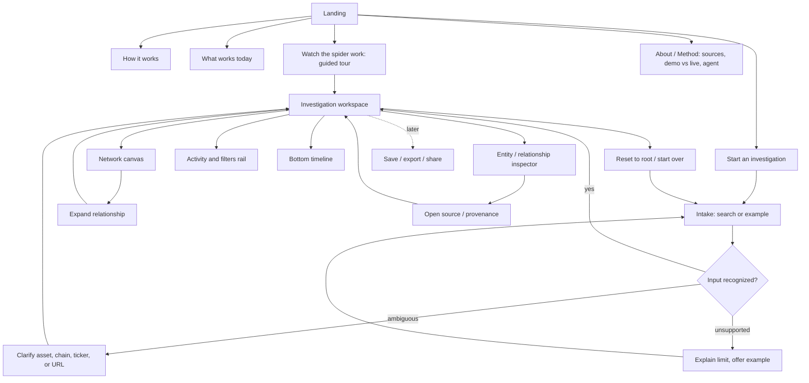
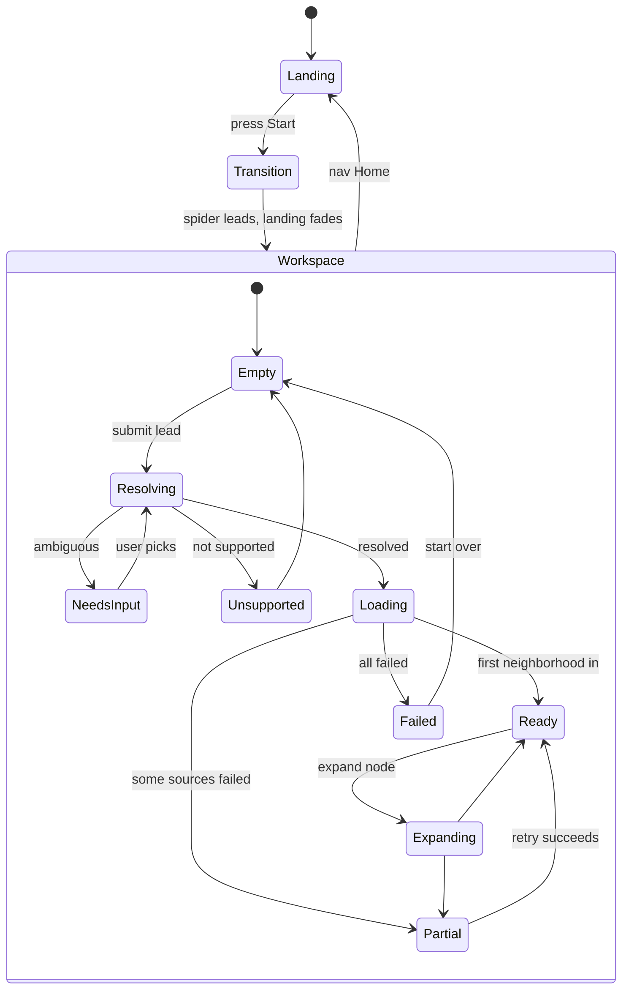
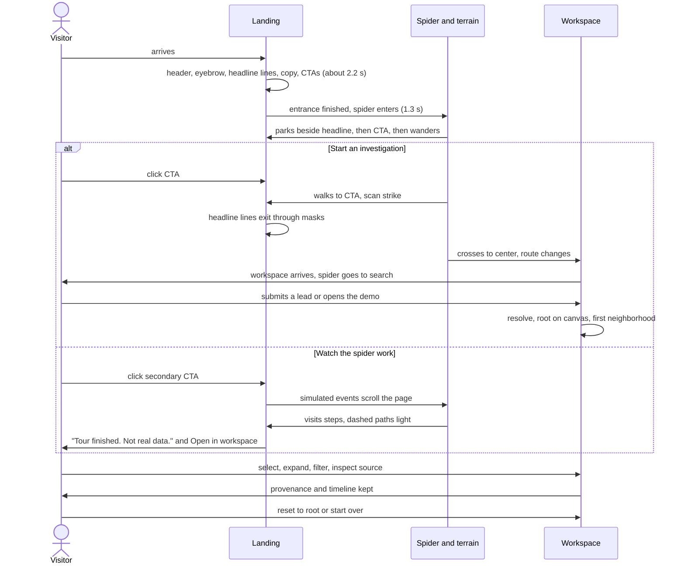

# Experience Map

Status: sitemap and journeys are **proposed**; the routes listed under "Current routes" are **confirmed by repository**.

## Current routes (confirmed by repository)

One HTML document, hash routing in `js/router.js`:

| URL | View | Content |
|---|---|---|
| `/` or `#top` | landing (`#landing`) | hero, How it works (with story graph), What works today, final CTA, footer |
| `#how`, `#status` | landing anchors | smooth scroll within landing |
| `#/investigate` | terminal (`#terminal`) | investigation workspace: search, activity, SVG graph, inspector (see TERMINAL_SPEC section 9) |

There is no 404 view, no per-investigation URL, and no history beyond hash changes.

## Product sitemap (proposed)

Keep navigation small until capabilities exist. Nav items follow working features only.

Navigation proposal: **Investigate** (primary), **How it works**, **Status**, later **Recent** and **Method**. Watchlists only when refresh logic exists. Current nav (Home, How it works, Status, Terminal) is **confirmed by repository**; renaming "Terminal" to "Investigate" is **proposed**.

## Primary journey

1. Visitor lands. Within seconds they read what OpenCrawl does (headline, subhead). The spider enters after the headline settles and parks beside content.
2. They either press **Start an investigation** or **Watch the spider work** (a guided simulated tour on the landing page).
3. The CTA transition: the spider walks to the button, then leads the view change. Landing fades, terminal appears, the spider goes to the search field.
4. In the workspace they enter a lead or choose an example. Intake resolves it, asks for clarification, or explains a limit.
5. The root subject appears anchored in the canvas with a small set of supported relationships.
6. Selecting a node or edge updates the inspector without losing canvas context.
7. Expanding one relationship adds neighbors and one line to the timeline.
8. The inspector shows provenance for every claim; facts, derived values, hypotheses, and unavailable data look different.
9. The user can reset to root, adjust filters or time range, or start over.

Today (confirmed by repository, 2026-10-12): steps 1 to 3 work; step 4 resolves only the demo (other input shows "Not supported yet"); steps 5 to 9 work on the demo dataset except filters, the timeline, and save/recents.

## Landing page sections (proposed order, current state in brackets)

1. Hero [implemented].
2. How it works: start with a lead, follow connections, inspect the evidence [implemented as 5 steps plus a story graph].
3. Interactive miniature investigation, deterministic, never a fake live scan [partial: the guided tour + story graph].
4. What can be investigated, only supported domains, planned ones marked [not built; status section covers part].
5. Trust and provenance: how sources, timestamps, direct vs inferred, and demo vs live are handled [not built].
6. Final CTA [implemented].

The workspace must stay reachable from the first screen and the nav at all times.

## State transitions

## Finalized end-to-end journey (design review 2026-10-12, proposed)

**Landing, step by step.** (1) Original background visible; (2) header; (3) eyebrow then headline lines; (4) subhead, CTAs, capability row; (5) spider enters and parks beside the headline and CTA; (6) idle: sparse ambient visits, no text motion; (7) scroll: sections reveal once, the story graph draws, the spider visits the matching node; (8) final CTA.

**"Start an investigation".** Spider walks to the CTA and scans; headline exits; spider crosses; route changes after about 1.4 s; workspace arrives in order; spider goes to the search field. Total about 2.2 s, skippable by any key or click. Opening the workspace does not submit anything: the user supplies a lead or presses Open the demo.

**"Watch the spider work".** Stays on the landing page; the guided simulated tour (labeled Simulated) scrolls the page and links the steps; at the end it offers to open the same demo in the workspace.

**Returning.** The workspace keeps a Recent list of the last five investigations (demo ones are rebuilt from input plus dataset version, DEC-023). Browser Back returns to the landing page or the previous workspace state.

**When everything has finished.** Still headline and copy, dormant terrain, a parked or slowly visiting spider, no lit paths, no looping text effect.

## Cross-surface rules

- Subject, scope, time range, filters, and Demo/Live status are always visible in the workspace.
- Browser back returns to the previous view (router uses `history.pushState`; per-investigation URLs are **proposed**, see TERMINAL_SPEC).
- Everything reachable by keyboard; no function depends on hover alone.
- The landing spider and the workspace spider follow different behavior contracts (DEC-009).
