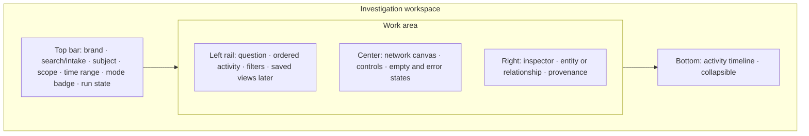

# Terminal / Investigation Workspace Spec

Status: **proposed** (nothing here is built except what Section 1 lists as confirmed). "Terminal" means a visual investigation workbench, not a command line (DEC-006). A search/command input exists, but the main surface is inspectable.

## 1. Starting point (historical)

Before 2026-10-12 the terminal was a demo-only page: a text field that ran a canned simulation for any input, an activity log, a four-node placeholder web, a findings list, and a chart empty state, rendered by the removed `js/terminal.js`. It had no real graph, selection, inspector, provenance, or honest handling of unsupported input. What replaced it is listed in section 9.

## 2. Layout map



### Desktop (proposed starting ranges, validate in browser)

The annotated wireframe is in section 8.1 (single source for the layout drawing).

- Top bar is stable and compact (about 56 px). It never scrolls away.
- Left and right panels collapse independently; the canvas takes the freed space.
- Timeline defaults to a single summary line (latest event, count, status) and expands to about 220 px.
- The spider (if enabled) lives over the canvas only (DEC-009).

### Mobile (below about 720 px)

Annotated drawing in section 8.2; the rules:

- Top bar: logo, search icon (expands to full-width field), mode badge, overflow menu.
- One main pane at a time with a three-tab bar at the bottom: **Graph**, **Activity**, **Inspector**.
- Selecting a node on the Graph tab slides up a bottom sheet (half height) with the inspector; drag up for full, down to dismiss.
- Timeline is the Activity tab. Filters are a sheet from the top bar.
- Pinch/pan for the graph; every control has a 44 px minimum target; no hover-dependent function.
- The spider is off by default on mobile in the workspace; the landing keeps it.

## 3. Components

### 3.1 Top bar
- **Search / intake:** one input accepting address, transaction hash, token name or ticker or contract, equity ticker, URL. Raw input is preserved. Shows detected type as a chip (for example "Address, chain unknown") before submit.
- **Subject:** current root, with type icon, display name, copy-able identifier.
- **Scope:** chains/markets/sources in play, as a chip group with a count; opens the scope sheet. Shows which providers are available, unavailable, or demo.
- **Time range:** presets (24h, 7d, 30d, all available) plus custom; affects canvas and lists; always displayed.
- **Mode badge:** `Demo` or `Live`, never hidden. Live shows last refresh time.
- **Run state:** shows agent status (Section 6) with Pause and Stop only when an agent is truly running.

### 3.2 Left rail
- **Question:** the investigation's stated lead and goal (editable later).
- **Ordered activity:** compact steps the user and agent took (resolved, expanded, checked source), each linked to the affected node. Not a raw log.
- **Filters:** entity type, relationship type, direction, amount range, time. Each filter states what it filters and shows an active count. "Clear all" visible when any is active.
- **Saved views:** deferred (DEC-011).

### 3.3 Network canvas
Rules:
- Start with a small, coherent graph (root plus a bounded first neighborhood). Expansion is explicit and capped; capped results say "showing N of M".
- Root entity visually anchored.
- Consistent encoding (DESIGN_SYSTEM): node shape and icon by entity kind; edge style by relationship status; arrowheads show direction; labels progressive by zoom.
- Controls: zoom in/out, fit to view, focus root, clear selection, expand selected, collapse. Undo for the last expansion.
- Selection by click, tap, or keyboard (Tab to move through nodes in a documented order, Enter selects, E expands, Esc clears). The graph also has a list view (a table of the same nodes and edges) as the accessible alternative.
- Edge hover shows a preview (type, value); click or Enter opens the inspector.
- Large-graph strategy: expansion limits, clustering of low-value neighbors into "N more" nodes, no unbounded render.
- Renderer: SVG with precomputed layout first (DEC-007). Graph rendering is independent of the spider and terrain layers.

### 3.4 Inspector (right)
Predictable structure, no modals.

**Entity** (order fixed):
1. Kind icon + canonical display name + status chips (Demo/Live, Stale).
2. Key identifier with copy action.
3. Chain, market, or source; last updated.
4. Overview metrics, only if backed by data (otherwise the section is omitted, not zeroed).
5. Connected entities (top by relevance, with "show all").
6. Recent activity.
7. Provenance list (each item opens source detail).
8. Actions: focus in graph, expand connections, add note (later), bookmark (later).

**Relationship**:
- Type label, direction, endpoints.
- Status: direct observation / provider-labeled association / derived / hypothesis / demo.
- Amount, unit, time when present; otherwise "not available".
- Source and direct evidence; method for derived claims.
- Confidence only if a documented method exists (DEC-013); otherwise absent.
- Conflicts shown side by side with timestamps (never silently chosen).

### 3.5 Bottom timeline
- Chronological list of domain events (investigation started, input resolved, source requested, observed, entity discovered, relationship discovered/verified/disputed, expansion, user action).
- Click an item to select and center its subject. Filter by status. Collapsed by default.
- Time-range scrubber (volume histogram) is **proposed** only when live data exists (Arkham pattern, see REFERENCE_LIBRARY).

## 4. Intake behavior

Order: normalize without destroying raw input, detect type and context, ask if ambiguous, query configured providers only, show per-provider status, open workspace with root, scope, provenance. With no live provider, offer the demo path and say live lookup is unavailable. Seeded data is never shown as an observation.

## 5. State matrix

| State | Trigger | What the user sees | Spider and terrain cue |
|---|---|---|---|
| Empty | no investigation | explanation, accepted input types, example button | idle, calm |
| Resolving | submit | skeleton root, status "Resolving" | spider moves to the search field |
| Needs input | ambiguous | list of candidates, choose to continue | spider waits at the chips |
| Unsupported | no adapter | what is unsupported, nearest alternative | none |
| Loading | provider call | per-provider progress, canvas skeleton | scan only if an action targets a node |
| Ready | data in | graph, inspector prompts selection | none |
| Partial | some providers failed | graph with "partial" banner naming missing sources | failed targets mark with fail tone |
| No connections | adapter returned none | says none found vs unsupported vs provider empty | none |
| Blocked | rate limit, permission | cause, what was done, next safe action | fail tone |
| Error | unexpected | concise cause, retry, keep context | fail tone |
| Stale | data older than threshold | stale chip with age, refresh action | none |
| Conflicting | sources disagree | both values, times, sources | amber marker on edge |
| Demo | demo adapter | persistent Demo badge | dashed connection style |

## 6. Agent status model

`Idle`, `Resolving`, `Observing`, `Tracing`, `Checking`, `Finding`, `Completed`, `Needs input`, `Blocked`, `Error`. A status is shown only if a matching event exists; a simulated demo may animate them and carries the Demo badge. "Completed" never means "correct". Approval: any action that goes beyond read-only observation (submit forms, send data, open a new origin the user did not name) pauses at `Needs input` with an explicit approve/deny. Private reasoning is never shown; show action summaries and evidence references.

## 7. Keyboard map (proposed)

`/` focus search · `Esc` clear selection or close sheet · `Tab`/`Shift+Tab` move through landmarks and nodes · `Enter` select · `E` expand selected · `F` fit · `R` focus root · `[` `]` collapse left or right panel · `T` toggle timeline · `?` shortcuts.

## 8. Wireframes (design review 2026-10-12, proposed)

These wireframes are structural, not visual comps. Visual language comes from `docs/design/DESIGN_SYSTEM.md` (flat near-black violet surface, hairlines, one accent). Numbers refer to the legend below each drawing.

### 8.1 Desktop (about 1280 x 800), investigation open

```
+----------------------------------------------------------------------------------------+
| (1)logo | (2)[/ address, token, ticker, tx, or URL .................] | (3)Subject  (4)Scope  (5)Time | (6)Demo (7)Idle (8)Calm |
+--------------------+-------------------------------------------------+-----------------+
| (9) Question       | (12) toolbar: [-][+][Fit][Root][Clear][List]  (13) Legend            | (15) Inspector  |
|  "Who is around    |                                                 |  [Entity|Rel.]  |
|   demo:wallet:7?"  |         (14) CANVAS                             |  ---------------|
| (10) Activity      |                                                 |  kind, name     |
|  1 Resolved        |        o---->O====>o                            |  id [copy]      |
|  2 Expanded        |       /      |                                  |  chain, updated |
|  3 Checked source  |      o       o                                  |  metrics*       |
| (11) Filters       |                                                 |  connected      |
|  type  dir  amount |   [banner: Partial - 1 of 3 sources failed]     |  activity       |
|  time  [Clear all] |                                                 |  (16) Provenance|
|  (17) Findings     |                                                 |  actions        |
+--------------------+-------------------------------------------------+-----------------+
| (18) Timeline [v]  latest: "Expanded wallet W7, +4 entities"  ·  9 events  ·  filter     |
+----------------------------------------------------------------------------------------+
  * metrics shown only when backed by data
```

| # | Element | Behavior |
|---|---|---|
| 1 | Brand mark | link to landing; never covers the search |
| 2 | Search / intake | `/` focuses; shows a detected-type chip while typing; Enter submits; preserves raw input; Esc clears |
| 3 | Subject | current root: kind icon, name, copyable identifier; click centers the root |
| 4 | Scope | chip with provider count (for example "2 sources"); opens the scope sheet listing each provider as available, unavailable, or demo |
| 5 | Time range | presets and custom; always visible; changes filter the canvas and lists |
| 6 | Demo / Live badge | persistent; Live adds "refreshed 12:04" |
| 7 | Run state | Idle, Resolving, Observing, Tracing, Checking, Finding, Completed, Needs input, Blocked, Error; Pause and Stop appear only when an agent is running |
| 8 | Calm | toggles the spider and terrain strikes (8.4) |
| 9 | Question | the stated lead and goal; editable later |
| 10 | Activity | ordered plain-language steps; click selects the affected node |
| 11 | Filters | type, relationship, direction, amount, time; each shows an active count; Clear all |
| 12 | Canvas toolbar | zoom, fit, focus root, clear selection, list view toggle |
| 13 | Legend | node shapes and line styles (DESIGN_SYSTEM); always one click away |
| 14 | Canvas | SVG graph (DEC-007); root anchored; banner slot for partial, stale, conflict |
| 15 | Inspector | entity or relationship tab; no modals |
| 16 | Provenance | list of observations and sources for what is selected |
| 17 | Findings | ordered findings with evidence links and Demo tags |
| 18 | Timeline | collapsed to one line by default; expands to about 220 px |

Widths: left 250 to 300 px, inspector 300 to 360 px, top bar 56 px. At 1100 px and below the inspector becomes a right drawer opened by selection; at 720 px and below see 8.2.

### 8.2 Mobile (about 390 x 760)

```
 Graph tab                    Inspector sheet (half)         Activity tab
+------------------------+   +------------------------+   +------------------------+
| logo  [Q] Demo  Idle  : |   | (graph dimmed above)   |   | logo  [Q] Demo  Idle  : |
+------------------------+   |========================|   +------------------------+
| [-][+][Fit][Root] [List]|   | ---                    |   | Question               |
|                        |   | Wallet demo:wallet:7   |   | Activity (ordered)     |
|     o---->O====>o      |   | id [copy]  Demo        |   |  1 Resolved            |
|    /      |          |   | Relationship: transfer |   |  2 Expanded            |
|   o       o          |   | Provenance (2) >       |   | Filters  [sheet]       |
|                        |   | [Expand] [Focus]       |   | Timeline rows          |
+------------------------+   +------------------------+   +------------------------+
| Graph | Activity | Inspector                                                       |
+---------------------------------------------------------------------------------+
```
- One pane at a time; a three-tab bar at the bottom. `Q` opens a full-width search. `:` opens an overflow menu (Scope, Time, Calm, Legend).
- Selecting a node or edge opens the inspector as a bottom sheet at half height (drag up for full, down to dismiss). Selection is kept when dismissed.
- Pinch and pan on the graph; every target at least 44 px; no function depends on hover; the list view is the default for screen readers.
- The spider is off by default in the workspace on mobile.

### 8.3 Interactions

For each: what the user sees, what they can do, what changes, what data is required.

| ID | Interaction | User sees | Can do | State change | Data required |
|---|---|---|---|---|---|
| I1 | Submit a lead | status Resolving, root skeleton on canvas, input echoed | cancel with Esc or Stop | `investigation.started`, `input.resolved` or `agent.needs_input` | raw input, detection result, adapter capabilities |
| I2 | Ambiguous input | chips "Ethereum address", "Solana address" etc. | pick one, edit input | investigation waits in Needs input; nothing is fetched until chosen | candidate list from `resolve()` |
| I3 | Select a node | selection brackets on the node; inspector shows the entity; row highlights in activity | Tab through nodes, Enter, Esc, click blank to clear | `graph.node.selected` (local UI state only) | entity, attributes, observations |
| I4 | Select an edge | edge brackets and thicker line; inspector Relationship tab | same as nodes | `graph.edge.selected` | relationship, observations, sources |
| I5 | Expand a node | new neighbors emerge from the node; banner if capped ("showing 12 of 38") | `E`, button, undo | `source.requested`, `source.observed`, `entity.discovered`, `relationship.discovered`, `graph.neighborhood.expanded` | adapter `expand()` result with limits |
| I6 | Filter | chips with counts; canvas dims excluded items (never deletes) | change, clear all | filter state only; filtered edge set drives canvas, list, and counts | relationship fields: type, direction, amount, time |
| I7 | Time range | range shown in top bar; items outside dimmed | presets, custom | time filter | `observedAt` or `validFrom/To` |
| I8 | Timeline | one-line summary, expandable list | click a row to select its subject; filter by status | none | ordered domain events |
| I9 | Guided tour in the workspace | a labeled Demo run walks `demo-v1` step by step with the spider acting at each node | pause, skip, stop | domain events from the demo adapter | deterministic dataset |
| I10 | Return to a prior investigation | Recent list (last 5) in the left rail and on the empty state | open one | the investigation is rebuilt by replaying `{input, adapterId, datasetVersion}` | stored input and seed only, not stored results (DEC-023) |
| I11 | Failure mid-run | banner naming what failed; graph stays | Retry, Continue with partial | `agent.blocked` or `investigation.failed` plus a partial flag | provider status, retryable flag |
| I12 | Keyboard | focus ring on current region and node | `/` search, Tab, Enter, E, F, R, [ ], T, ?, Esc | per key | none |

### 8.4 Spider and Calm control in the workspace

Goal: the creature adds orientation without ever costing usability.
- **Where:** a transparent canvas limited to the graph region (the canvas element is clipped to it). It never draws over the inspector, left rail, timeline, or top bar.
- **When it moves:** only to a node or edge that a domain event acts on (via the motion bridge), at 1.0 scale. It is otherwise parked at the canvas edge, small and still.
- **Auto-yield:** during direct manipulation (drag, pan, zoom, typing in search or filters) and for 4 s after, the spider fades to 35% opacity and holds position; it resumes afterward.
- **Terrain light:** absent. The workspace has a flat surface. The attention mark is the corner-bracket selection mark and a short line along the relevant edge.
- **Calm control:** a labeled toggle in the top bar (`Spider: On / Calm`), keyboard `C`. Calm hides the spider and silences strikes and scans; events still show the bracket mark on their target for 1.4 s and a plain log line. The choice persists in `localStorage` (a per-viewer preference) and defaults to Calm when `prefers-reduced-motion` is on or the viewport is under 720 px.
- **Never:** blocks pointer or keyboard input, scrolls the workspace, or moves during a modal-like state (scope sheet, mobile sheet).

### 8.5 Evidence, provenance, timestamps, confidence

Inspector, relationship tab (illustrative; fields appear only if supported):

```
transfer                          [Direct] [Demo]
demo:wallet:7  ------>  demo:token:3
Amount   not available            Time  observed 2026-10-12 09:14 (UTC+0)
Evidence (2)
  1. demo_dataset  demo-v1  retrieved 12:01  raw
  2. demo_dataset  demo-v1  retrieved 12:01  derived: method "net flow"
Conflicts  none
Confidence not scored (no documented method)
```
Semantics:
- **Status chips** are exactly the five relationship statuses; color is never the only cue.
- **Verified** is a separate, computed chip allowed only when all conditions in `docs/architecture/DATA_MODEL_AND_PROVENANCE.md` ("Verified") hold. Demo data never shows Verified.
- **Timestamps** always show observed and retrieved times with timezone; stale items show age.
- **Confidence** is not displayed as a number unless a documented method exists; until then the row reads "not scored".
- Every provenance item opens the source detail (title, reference, limitations).

### 8.6 State copy (sentence case, no apology)

| State | Heading | Body | Action |
|---|---|---|---|
| Empty | Start with a lead | Enter an address, token, ticker, transaction, or URL. | Open the demo |
| Resolving | Resolving | Identifying what this input is. | Cancel |
| Needs input | Which did you mean? | This could be an address on more than one network. | choices |
| Unsupported | Not supported yet | OpenCrawl cannot look up this kind of input. | Try the demo |
| Loading | Reading sources | 2 of 3 sources responded. | Stop |
| Partial | Partial results | News source unavailable. The graph shows the other sources. | Retry |
| No connections | No connections found | The demo dataset has none for this subject. (Live: names which case.) | Back to root |
| Stale | Data is 3 h old | Last refreshed 09:14. | Refresh |
| Conflicting | Sources disagree | Two sources report different amounts. Both are shown. | View both |
| Blocked | Rate limited | The provider asked us to wait 30 seconds. | Retry later |
| Error | Could not read this source | Your investigation is kept. | Retry |
| Demo | Demonstration data | Not real market or chain data. | Learn how it works |

## 9. Implementation status (updated 2026-10-12)

What exists in the repository now (source: `main.js`, `js/workspace/`, `js/investigation/`, `js/model/`; verified in Chrome at 1470x779 and in a 390 px frame; model logic by `node tests/model.check.mjs`, 11 checks):

| Capability | Status | Where |
|---|---|---|
| Search/intake field with detected-type chip, Open the demo, unsupported state | implemented (demo-only) | `index.html`, `js/investigation/demo-adapter.js` |
| Subject, Demo badge, run state, Calm toggle in the top bar | implemented | `js/workspace/workspace.js` |
| Left rail: question and ordered activity (items select their node or edge) | implemented | `workspace.js` |
| Canvas: SVG graph, root anchored, select node and edge, expand (capped at 2 with a "Showing N of M" banner), fit, root, clear, zoom, pan, list view, corner-bracket selection | implemented (demo-only) | `js/workspace/graph-view.js` |
| Inspector: entity and relationship, provenance details, conflict display, not-verified verdict, "not scored" confidence | implemented (demo-only) | `js/workspace/inspector.js` |
| Canonical model, demo dataset `demo-v1`, queries, Verified rule | implemented | `js/model/` |
| Domain events, controller, reducer, motion bridge with cue queue | implemented | `js/investigation/` |
| Workspace spider contract: clipped to the canvas, parked, event-driven, auto-yield, Calm (persisted) | implemented (first version) | `main.js`, `js/spider/choreography.js` |
| Keyboard: `/`, `Esc`, `F`, `R`, `L`, `C`, `E`; Tab and Enter on nodes and edges | implemented | `workspace.js`, `graph-view.js` |
| Mobile: tabs (Graph, Activity, Inspector), half-height inspector sheet, 40 px controls | implemented (first pass) | `styles.css` |
| Scope chip and time range | planned (no data to scope) | none |
| Filters (type, status), findings list, collapsible bottom timeline (`T`) | implemented | `workspace.js` |
| Ambiguity ("Which did you mean?") | implemented | `demo-adapter.js`, `controller.js` |
| Loading skeletons, live stale and conflict banners | planned | conflict and stale shown in the inspector for the demo only |
| Legend on mobile, `[` `]` `T` `?` keys | planned | none |
| Recent list and replay | implemented (demo) | `js/investigation/recents.js` |
| Live data: Bitcoin mainnet addresses (recent transactions, expansion, Verified, links to transactions) | implemented | `js/investigation/bitcoin-adapter.js`, `controller.js` |
| Other chains, equities, web sources, a real agent | planned | none |

Live data (2026-10-12): paste a Bitcoin address (legacy or bech32). The workspace shows a Live badge, reads up to 25 recent confirmed transactions plus pending ones from the public Blockstream API, shows the 10 most recent counterparties first ("Showing 10 of N"), expands 8 more per click, marks relationships Verified only under the rule in DATA_MODEL, and links each to its transaction. Failures show an error banner and change nothing.

Known gaps in what shipped: the legend is hidden below 720 px; the graph fit can leave labels near the right edge tight at 390 px; selecting an edge shows its connection path only as the spider's silk (no terrain light in the workspace by design); reduced-motion behavior of the workspace was exercised through code paths (animations are disabled by the shared media rule and the controller delay is 0), not by switching the operating system setting.
