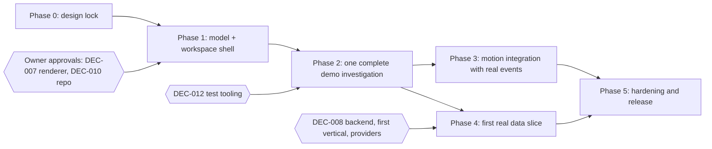
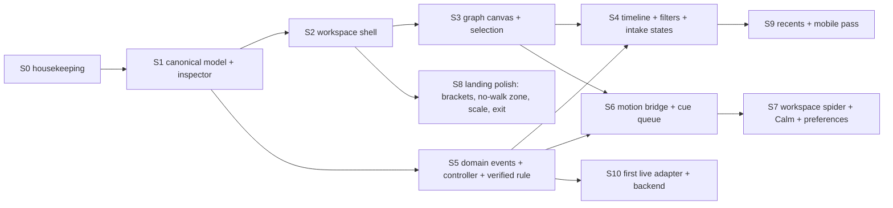

# Implementation Roadmap

Status: **proposed**. Phase 0 is complete when the owner approves the decisions in `docs/DECISIONS.md`. Phase numbers follow the master brief; Phase 1 and 2 are re-cut here around what the repository already has.

Dependencies in words: Phase 1 needs DEC-007 and DEC-010. Phase 2 needs a runnable test decision (DEC-012). Phase 3 can start after Phase 1 for the bridge and in parallel with Phase 2 for polish, but its exit depends on Phase 2 events. Phase 4 needs DEC-008 and a chosen vertical, and can proceed in parallel with Phase 3.

## Phase 0: discovery and design lock (this phase)

Deliver: repository and asset inventory; baseline checks; reference library; the document set in `docs/` and root `CLAUDE.md`; decision log with owner-approval items; maps. **No application code changed.**
Exit: owner reviews the docs and approves or edits the decisions; no unresolved conflicts between docs.

## Phase 1: canonical model and workspace shell

Deliver:
- `js/model/`: entity, relationship, source, observation types (JSDoc typedefs), id helpers, `demo-v1` dataset, pure query helpers (neighbors, filter, path).
- Workspace shell: top bar, left rail, canvas area, inspector, collapsed timeline, all static, from the model, with empty, loading, partial, error, demo states.
- Existing landing page and spider unchanged.

Exit: workspace renders from the model without animation; keyboard reaches every region; Demo badge always visible; 390 px layout usable (tabs and sheet); reducers and queries tested under Node.

## Phase 2: one complete demo investigation

Deliver: intake with detected-type chip and the ambiguity and unsupported states; SVG graph canvas (select, expand one layer, fit, focus root, clear); entity and relationship inspector with provenance; timeline built from domain events; reset to root; a simulated controller emitting domain events from the demo adapter.

Exit: a user completes the full journey (search, root, select node, select edge, expand, inspect source, reset) with no dead ends; each state in TERMINAL_SPEC is reachable; no misleading states; pure code tested; scripted browser smoke test passes.

## Phase 3: motion integration

Deliver: motion bridge (domain events to `agent.*` cues); workspace spider contract (DEC-009); contact and scan effects driven by real demo events; connection path bound to selected relationship (dashed for demo); reduced-motion `change` listener and a Calm control; `shadowBlur` replaced by sprites; ambient-loop resilience fix.

Exit: every visible effect traces to an event; frame time measured on target hardware and recorded; reduced motion verified with the actual system setting; headline and inspector text never covered; no unbounded loops.

## Phase 4: first real data vertical

Pick one, based on credentials, licensing, rate limits, and reliability. Deliver: backend-for-frontend (DEC-008), one adapter behind the contract, normalization, provenance, failure modes, freshness, tests, visibly distinct Demo and Live.

Exit: every displayed live claim traces to a source and time; failure and partial states exercised with induced failures; no secrets in browser bundles.

## Phase 5: hardening and release

Responsive and input modes, accessibility audit (screen reader, keyboard, contrast), reduced-motion audit, performance budgets, security review of user URLs and any agent actions, self-hosted fonts, removal of unused third-party requests, tests for key states, docs aligned with reality.

Exit: Definition of Done below holds for every feature.

## Slices in dependency order (design review 2026-10-12)

Each slice is small enough to review alone. "Needs" lists blocking approvals or earlier slices. Do not start a slice whose decisions are unapproved.

| Slice | Delivers | Needs | Acceptance criteria |
|---|---|---|---|
| S0 | repo placement, remove dead Font Awesome link and legacy CSS, self-host fonts, `node` check script | DEC-010, DEC-012 | no behavior change; landing identical in screenshots; no third-party requests except approved |
| S1 | `js/model/` (types, ids, `demo-v1`, pure queries), inspector rendering from the model, Demo labeling | nothing (DEC-001 settled) | select any entity or relationship and see type, endpoints, status, source, times, Demo; Node checks pass; landing and spider unchanged |
| S2 | workspace shell regions, top bar, empty/loading/partial/error/blocked/demo states from the model, 390 px layout with tabs and sheets | S1 | every state in TERMINAL_SPEC 8.6 reachable; keyboard reaches every region; no horizontal scroll at 390 px |
| S3 | SVG canvas from the model: root anchored, select node and edge, expand one layer, fit, root, clear, list view, corner-bracket selection | S2, DEC-007 | full select-expand-inspect loop with keyboard and pointer; cap banner when limited; list view equals canvas contents |
| S4 | filters, time range, timeline, intake detection with ambiguity and unsupported states | S3, S5 | filtered edge set drives canvas, list, counts; ambiguity blocks fetching until chosen; timeline rows select nodes |
| S5 | domain events, investigation controller, demo adapter, pure `verification` rule, reducers on domain events | S1 | reducers and the Verified rule covered by Node checks; demo data never verified; events carry ids and timestamps |
| S6 | motion bridge, cue queue (drop rule), DOM target ids `node:` and `edge:`, terrain scan and connection driven by real events | S3, S5, DEC-020 | every effect traces to an event; data never waits for animation; solid path only for verified |
| S7 | workspace spider contract, auto-yield, Calm control and preferences store, reduced-motion live listener | S6, DEC-018 | spider never covers inspector or controls; Calm silences effects while still marking targets; preference persists |
| S8 | landing: bracket mark, no-walk zone, scale per breakpoint, exit choreography, optional contact tear | DEC-015 to DEC-017, DEC-021 | headline never overlapped at rest; choreography matches MOTION_SYSTEM timings; reduced motion verified with the system setting |
| S9 | Recent list and replay, mobile pass, accessibility audit | S4 | prior demo investigation reopens identically; screen reader and keyboard pass |
| S10 | one live adapter behind the contract plus a backend for credentials | DEC-008, DEC-019, vertical chosen | every live claim traces to a source and time; failure modes exercised; no secrets in the browser |

**Status 2026-10-12:** S1 (model, inspector), S2 (workspace shell; scope and time controls deliberately omitted until there is data to scope), S3 (SVG canvas, selection, expansion, fit, list view), the core of S5 (domain events, controller, reducer, Verified rule with tests), the core of S6 (motion bridge and cue queue), and a first version of S7 (workspace spider contract, Calm, preferences) are built. Remaining: S0, S4 (filters, timeline, ambiguity), S8, S9, S10, and the S7 live reduced-motion listener.

## Definition of done (any feature)

- UI state maps to real application state or an explicitly labeled demo.
- Works with mouse, keyboard, and touch where relevant.
- Loading, empty, error, blocked, success states exist.
- Provenance is inspectable wherever a claim or relationship appears.
- Works at desktop and 390 px.
- Reduced motion respected.
- Animation never breaks readability, hit targets, or navigation.
- No unbounded loops or trails.
- Checks pass or failures are documented.
- Governing docs and `docs/DECISIONS.md` updated.

## Recommended first slice (do not start without approval)

**Slice 1: the canonical demo model plus the inspector.** Create `js/model/` with the `demo-v1` dataset and pure queries, render the existing four-node placeholder from it, and add the inspector for entities and relationships including provenance and Demo labeling. It touches the least existing code, makes every later UI state concrete, and unblocks the graph canvas, the bridge, and adapters. Acceptance: select any entity or relationship from the model and see type, endpoints, status, source, observation time, and a Demo badge; unit checks pass in Node; landing and spider unchanged.
